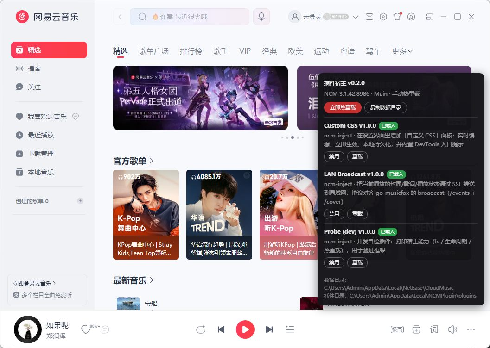
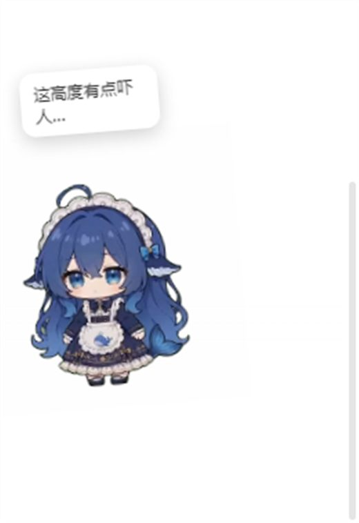

# NCM Plugin Framework

给**网易云音乐 PC 版**加插件的框架：一个原生注入层 + 一个页面插件宿主，插件写成
`manifest.json` + `startup_script.js` 就能跑。



支持：插件管理面板 · 自定义 CSS · 桌宠接管 · 局域网投送 · DevTools 调试。

> 仅限个人学习与技术研究使用。请勿用于商业分发或绕过版权保护。
> 当前适配 **网易云 3.1.42.205594**（`libcef 91.2.3`），客户端升级后可能需要重新定位注入点。

---

## 一、它是怎么工作的

### 1.1 三层结构

```
cloudmusic.exe
  └─ msimg32.dll（代理）              ← 系统会加载它，我们借壳
       └─ ncm-inject.dll 本体
            ├─ IAT 钩子（libcef）      ← 在 CEF 初始化前改函数表
            ├─ LoadByUrl 钩子          ← 把页面载荷塞进 JS 文件
            ├─ 本地服务 127.0.0.1:38021 ← 页面 ↔ 原生通道
            └─ SSE 服务 127.0.0.1:8790  ← 事件推送（含桌宠交互）
页面（orpheus://orpheus/pub/app.html）
  └─ ncm-page.js（插件宿主）
       └─ plugins/*.plugin/          ← 你的插件
```

### 1.2 注入层：借 `msimg32.dll` 的壳

网易云的 `cloudmusic.dll` **静态导入了 `msimg32.dll`**，而安装目录里原本没有这个文件
（它在 `System32`）。我们把同名 DLL 放进安装目录 → 系统优先加载我们的 → 我们的代码就进了进程。

进去之后在 `DllMain` 里改 CEF 的导入地址表（IAT）：`libcef` 的导入描述符排在
`MSIMG32` 之前，加载器先回填 `libcef` 的槽位，所以这个时刻替换**零竞争**。

### 1.3 页面层：往 JS 文件里加料

`ResourceLoader::LoadByUrl` 被 inline hook 后，凡是加载 `*.chunk.js` 的请求都会在
返回前把 `ncm-page.js` 追加到末尾。追加时必须按 MSVC 的 `std::vector` 扩容规则重新分配，
否则宿主的 vector 析构会踩坏堆（会触发 `invalid_parameter` 崩溃）。

### 1.4 插件层：宿主负责发现与生命周期

页面载荷启动后：

1. 向原生 `GET /host` 拉插件清单（含每个插件的 `manifest` 与脚本源码）
2. 逐个 `new Function(script)` 执行，注入一个按 slug 隔离的 `ncm` 对象
3. 插件调 `ncm.onDispose(fn)` 注册清理；卸载/重载时先跑清理

### 1.5 原生能力：页面没有的能力放原生

浏览器页面开不了端口、读不了本地文件，所以这些都由原生提供，页面走
`http://127.0.0.1:38021`：

| 端点 | 作用 |
|---|---|
| `GET /host` | 宿主信息 + 插件清单（`manifest` / `script` / `mtime`） |
| `GET /fs/read` `POST /fs/write` | 插件沙箱读写 |
| `GET /fs/list` `GET /fs.stat` `POST /fs/remove` | 列目录 / 元信息 / 删除 |
| `GET /asset?path=` | 二进制资源（`video/webm`、图片等，支持 Range） |
| `POST /log` | 页面日志落盘（插件 `ncm.log` 走这里） |
| `GET/POST /custom-css` | 自定义 CSS 持久化 |
| `GET /bcast-port` | 局域网投送实际端口 |

### 1.6 桌宠接管是怎么做到的

网易云的桌宠是一个**独立的 CEF 离屏渲染窗口**（类名 `CloudMusicDesktopPetOsrView`，
透明、置顶、逐像素 alpha），页面地址是 `subApp.html?route=pet-desktop`。
它自己的宠物是 21 个带 alpha 的 `<video>` 在轮播。

我们的做法：

1. 用 `!important` CSS 把原生 `<video>` 全部隐藏（普通样式压不住，App 每帧会重置）
2. 在 `#pet-desktop-renderer` 里放自己的双缓冲 `<video>`，播放 dsh-pet 的 webm 素材
3. 交互由**原生旁路**提供 —— 这个窗口只把 `mousemove` 转发进页面，按键事件全丢；
   且它返回 `HTCAPTION`，拖动走的是系统窗口移动循环。于是原生子类化它的 `WndProc`，
   把 `down / dragstart / drag / drop / click` 经 SSE 推给插件



---

## 二、安装

### 2.1 一键包（推荐）

从 [Releases](https://github.com/RemKeeper/ncm-plugin-framework/releases) 下载
`ncm-plugin-framework-<版本>.zip`：

1. 解压到任意目录
2. **右键 `install.cmd` → 以管理员身份运行**（脚本自己要写 `Program Files`）
3. 脚本会：自动定位网易云目录 → 结束运行中的进程 → **备份原 `msimg32.dll`** →
   安装 DLL + 页面载荷 + 示例插件
4. 结束时可以直接启动网易云

### 2.2 手动安装（开发者）

需要 **Visual Studio Build Tools**（MSVC x64，含 `ml64`）。

```bat
cd ncm-inject
build.bat                     :: 产物 build\msimg32.dll
```

```powershell
# 必须管理员身份；会校验复制是否真的成功
pwsh -File ncm-inject\deploy.ps1
```

> ⚠️ **一定要用管理员权限**。普通权限下复制到 `Program Files` 会失败，
> 脚本现在会直接报「部署失败：… 与构建产物不一致」，不会再假装成功。

### 2.3 装完怎么确认

启动网易云后看两处：

- 窗口右上角图标行（私信/设置/皮肤/宠物 右侧）多出一个**音符小图标** → 注入成功
- 日志：`%LOCALAPPDATA%\NCMPlugin\inject-*.log` 里出现
  `注入: ✅ orpheus://…` 和 `插件装载完成：N 个`

---

## 三、使用

### 3.1 插件管理面板

点右上角的**音符图标**打开：

- 查看每个插件的状态（已载入 / 已禁用 / 出错）
- **禁用 / 启用**（写入 `data\disabled.json`，立即生效）
- **重载**：改完插件脚本点它即可，不用重启应用
- **立即热重载** / **复制数据目录**

### 3.2 自定义 CSS

设置界面 → 「自定义 CSS」→ 编辑后点「保存并应用」。
保存位置：`%LOCALAPPDATA%\NCMPlugin\custom.css`。

### 3.3 桌宠接管

首次使用要下素材（约 52 MB，106 个 webm）：

```powershell
pwsh -File tools\fetch-pet-assets.ps1
```

重启网易云后，自带的泰迪熊会被换成 dsh-pet 的形象：

- **点击**：播「点击回应」动画 + 随机气泡台词
- **拖拽**：播「被拎起悬空」+ 轻微倾斜跟随，松手回待机
- **换歌**：播一个随机小动作 + 气泡报歌名

想换形象：把别的 `.webm` 丢进 `data\pet-override\assets\`，按
`待机呼吸休闲` / `点击回应-*` 命名就会被识别，**不用改代码**。

### 3.4 局域网投送

把当前播放的封面/歌词/播放状态用 SSE 推到局域网（协议对齐 go-musicfox）：

```bash
curl http://127.0.0.1:38021/bcast-port        # 查实际端口，默认 8790
curl -N http://127.0.0.1:8790/events          # 订阅事件流
curl -o cover.jpg http://127.0.0.1:8790/cover # 取当前封面
```

配置：`%LOCALAPPDATA%\NCMPlugin\broadcast.json`（`enable` / `port` / `bind`）。

### 3.5 开发：DevTools

```bat
tools\start-with-devtools.cmd
```

然后用 Chrome / Edge 打开 <http://127.0.0.1:9222>，可以完整调试页面
（控制台、元素、网络，以及 `window.__NCM__` 下的宿主对象）。

---

## 四、目录说明

### 4.1 安装目录（只动一个文件）

```
C:\Program Files\NetEase\CloudMusic\
  └─ msimg32.dll          ← 我们的代理 DLL（卸载就是换回原版）
```

原版 `msimg32.dll` 由安装器备份到 `%LOCALAPPDATA%\NCMPlugin\backup\msimg32.dll.orig`。

### 4.2 插件目录

```
%LOCALAPPDATA%\NCMPlugin\plugins\
  ├─ custom-css.plugin\
  │    ├─ manifest.json
  │    └─ startup_script.js
  ├─ lan-broadcast.plugin\
  ├─ pet-override.plugin\
  └─ 你的插件.plugin\
```

规则：

- **一个子目录 = 一个插件**，目录名就是 slug（习惯用 `xxx.plugin`）
- 必须有 `manifest.json`，入口脚本默认 `startup_script.js`
- 改完脚本在面板里点「重载」即可生效
- 目录结构变了（增删插件）需要重启应用让原生重新扫描

### 4.3 插件数据目录（沙箱）

```
%LOCALAPPDATA%\NCMPlugin\data\
  ├─ disabled.json              ← 被禁用的插件列表（面板维护）
  ├─ custom-css\                ← 某个插件的数据
  ├─ pet-override\
  │    └─ assets\*.webm         ← 桌宠素材
  └─ <你的插件slug>\            ← 你的插件专属目录
```

规则：

- 插件通过 `ncm.fs` 读写，**路径会自动加上自己的 slug 前缀**，插件之间互相看不见
- 拒绝绝对路径与 `..`（防止越界到系统目录）
- 写文件后立刻读也能读到（内部做了 stat 确认，避免缓存竞态）

### 4.4 其它文件一览

| 路径 | 说明 |
|---|---|
| `NCMPlugin\payload\ncm-page.js` | 页面插件宿主 |
| `NCMPlugin\inject-<角色>-<pid>.log` | 各进程注入日志 |
| `NCMPlugin\trace-<pid>.log` | 追踪日志（含插件 `ncm.log`） |
| `NCMPlugin\custom.css` | 自定义 CSS |
| `NCMPlugin\broadcast.json` | 投送配置 |
| `NCMPlugin\backup\msimg32.dll.orig` | 原版 DLL 备份 |

### 4.5 日志上限与轮转

日志不会无限增长，原生侧做了两道限制：

- **单文件上限**：默认 **8 MB**，超过就改名为 `<原名>.1`（旧的 `.1` 直接覆盖），
  再开一个新文件继续写；新文件开头会有一行
  `[--] 日志超过 8 MB，已轮转（旧内容见同名 .log.1）`
- **旧文件清理**：启动时按修改时间清理，`inject-*.log`、`trace-*.log` 及其 `.log.1`
  **各保留最新 10 个**

可用环境变量调整上限（对下次启动生效）：

```bat
set NCM_LOG_MAX_MB=8      :: 按 MB，1..256，默认 8
set NCM_LOG_MAX_KB=512    :: 按 KB（优先于 MB），16..262144，便于细调
```

> 排查问题时可以临时调到 `NCM_LOG_MAX_KB=4096`，这样几天前的现场不会被轮转掉。

---

## 五、写一个插件

### 5.1 最小插件

`plugins\hello.plugin\manifest.json`：

```json
{
  "manifest_version": 2,
  "name": "Hello",
  "slug": "hello",
  "version": "1.0.0",
  "author": "you",
  "description": "打个招呼",
  "startup_script": "startup_script.js"
}
```

`plugins\hello.plugin\startup_script.js`：

```js
ncm.log('info', 'hello 启动');

const el = ncm.ui.el('div', {
  position: 'fixed', left: '16px', bottom: '16px', zIndex: 2147483647,
  padding: '8px 12px', borderRadius: '8px', background: '#c62f2f', color: '#fff'
}, 'Hello from plugin');
document.body.appendChild(el);

ncm.onDispose(() => el.remove());   // 卸载/重载时清理
```

### 5.2 manifest 字段

| 字段 | 必填 | 说明 |
|---|---|---|
| `manifest_version` | ✅ | 目前为 `2` |
| `name` / `slug` / `version` | ✅ | 面板显示用；`slug` 建议与目录名一致 |
| `startup_script` | | 入口脚本，默认 `startup_script.js` |
| `description` / `author` | | 面板显示 |
| `ncm_version_req` | | 版本约束，如 `">=3.0.0 <4"`，不满足会跳过 |
| `injects` / `hijacks` | | 资源注入/改写（预留） |

### 5.3 插件可用的 API

| 分类 | API |
|---|---|
| 日志 | `ncm.log(level, msg)` → console + 落盘 |
| 事件 | `ncm.on/off/emit`、`ncm.onDispose(fn)` |
| 文件 | `ncm.fs.readText/writeText/list/stat/remove/readTextAsync` |
| 播放 | `ncm.player.current()`、`getProgress()`、`control.{play,pause,next,prev,isPlaying}` |
| 界面 | `ncm.ui.el(tag, style, text)`、`ncm.ui.mount(el)`、`ncm.ui.toast(msg)` |
| 原生 | `ncm.native.call(name, cb, args)` |
| 应用 | `ncm.app.isMainWindow`、`ncm.app.ncmVersion` |

`ncm.player.current()` 返回：

```js
{
  song:    { id, name, artist, album, durationMs },
  lyric:   { lines: [{ t, text, translation }], index, current },
  cover:   'https://…',
  audio:   { songId, url, quality, bitrate },
  progress:{ playedTime, at, playing }
}
```

歌曲与歌词走原生接口（`playId` → `api/v3/song/detail` → `api/song/lyric`），
不依赖界面是否打开了歌词页。

### 5.4 读写自己的数据

```js
await ncm.fs.writeText('config.json', JSON.stringify({ theme: 'dark' }));
const raw = await ncm.fs.readTextAsync('config.json');   // 实际路径 data\<slug>\config.json
const files = await ncm.fs.list('');                     // 列出自己目录
```

---

## 六、卸载

### 6.1 一键包

双击 `uninstall.cmd`（同样要管理员权限）：

- 从备份恢复原版 `msimg32.dll`（没有备份则直接删除）
- 移除 `payload\` 与 `plugins\`
- **保留** `data\`（你的插件数据、自定义 CSS 等）

### 6.2 手动卸载

```powershell
# 恢复备份
Copy-Item "$env:LOCALAPPDATA\NCMPlugin\backup\msimg32.dll.orig" `
          "C:\Program Files\NetEase\CloudMusic\msimg32.dll" -Force

# 可选：清掉运行时数据
Remove-Item "$env:LOCALAPPDATA\NCMPlugin" -Recurse -Force
```

---

## 七、故障排查

| 现象 | 排查 |
|---|---|
| 右上角没有音符图标 | 看 `inject-*.log` 是否出现 `注入: ✅`；没有则 DLL 没装好（多半是没管理员权限，或版本不匹配） |
| 图标在，但插件没加载 | 看日志里的「插件 xxx 载入失败」，或面板里是否被禁用（`data\disabled.json`） |
| 改了插件脚本没反应 | 面板里点「重载」；改的是 `manifest.json` 则需重启应用 |
| 桌宠没换 | 先跑 `tools\fetch-pet-assets.ps1` 下素材；再看 `trace-*.log` 里的 `素材 N 个` |
| 拖拽没效果 | 需要较新的 DLL（含 NC 消息处理）；`deploy.ps1` 现在会校验复制是否成功 |
| 投送连不上 | `curl http://127.0.0.1:38021/bcast-port` 查实际端口 |

**日志都在** `%LOCALAPPDATA%\NCMPlugin\`，排查先看 `inject-*.log`，插件自身的
`ncm.log` 输出在 `trace-*.log` 里（前缀 `JS `）。

---

## 八、已知限制

- **版本敏感**：注入点用硬编码 RVA，网易云升级后可能失效（当前适配 `3.1.42.205594`）
- **自动热重载默认关闭**：存在自我循环触发问题，改插件请用面板里的「重载」
- **页面定时器会被冻结**：窗口不可见时 Chromium 限制 `setInterval`，所以推送类功能走 SSE
- **原生播放接口不可用**：`setVolume` 等实测无效且参数错误会崩，播放控制一律走页面点击
- **接口有频控**：数据接口做了节流与退避，短时间内频繁切歌可能触发 405/406
- **需要管理员权限**：安装/卸载/更新 DLL 都要提权

---

## 九、致谢与许可

- 注入思路参考 [chromatic](https://github.com/std-microblock/chromatic)（BetterNCM 继任者）
- 插件规范（`manifest.json` 字段、`injects`/`hijacks`）参考 BetterNCM v2
- 桌宠动画素材来自 [dsh-pet](https://github.com/PC2005-cloud/dsh-pet)（MIT）

本项目为独立实现，未包含上述项目的代码。
